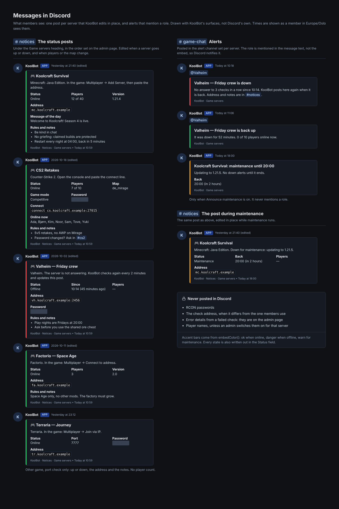

# Messages in Discord

What KoolBot posts in Discord (embeds, replies, buttons and DMs) speaks with the same voice as the Web UI. Discord is where most members meet KoolBot,
so this is the larger half of the brand.

## Embeds

- **Accent bar** from the six `embed-*` tokens, chosen by what the message is about, never by feature: `embed-brand` for KoolBot itself (help,
  welcome, notices headers, announcements by default), `embed-ok` when something worked or is on, `embed-warn` when it needs attention, `embed-danger`
  when something failed or was removed, `embed-neutral` for plain information, `embed-lore` for activity and history. Get them from `embedColor(kind)`
  in `src/utils/embed-style.ts`, never a hex literal.
  No Discord blurple, and no pure `0xff0000` or `0x00ff00`. The bar is decorative: the title always says what the message is.
- **A colour the community chose stays theirs.** Notice categories and custom announcements keep their own colour; `embed-neutral` is only the default.
- **Title:** sentence case, at most one emoji at the start, and only when it names a thing (📢 for notices, 🎮 for a game server). Field names carry no emoji.
- **Description:** one or two short sentences saying what this is and what to do with it. No "Welcome!" filler, no "All posts are managed by" boilerplate.
- **Facts go in fields** (`Address`, `Password`), not in the description as `Servername: …` lines. Inline fields for short values, three to a row at most.
- **Lists** use Discord's `-` list markdown, one line per item, `name: what it does`. A list item may start with one emoji when it names a feature.
- **Commands** in inline code with the slash and no option syntax (`/quote`, not `/quote text:"..." author:@user`). The option hints come from Discord itself.
- **Channels, roles and people as real mentions** (`<#id>`, `<@&id>`, `<@id>`), so Discord renders them, links them and shows the right icon. Never
  type `#channel` as text.
- **Footer:** `KoolBot · <Feature>` and, where it helps, the sub-area (`KoolBot · Notices · Game servers`). Never "System", never a database id. An id
  that people need goes in a button or in the Web UI, not in the footer.
  An instruction or a status is not a footer: it goes in the description or a field (`Use /modlog to view history` becomes a sentence in the
  description; a closed post's reason becomes a `Status` field). `__tests__/utils/discord-style-guard.test.ts` fails on a footer that does not start
  with "KoolBot ·".
- **Time:** the embed `timestamp`, or `<t:…:f>` / `<t:…:R>` in text, so each reader sees their own timezone and format. Never a preformatted date string.
- **Version** appears only on help and about messages, in the footer.

## Posts that track live state

A post that shows something live, such as a game server's status, is one message the bot edits in place.

- **Edit, never delete and re-post**, so members keep their place and links to the message keep working. If someone deletes it, the bot posts
  it again and keeps the new id.
- **The one exception is a reorder by an admin.** Discord cannot move a message, so the bot re-posts every post from the first one whose position
  changed, in the new order, and stores the new ids. Links to those old messages stop working; the Web UI says so before the reorder is saved.
- **The state is a word** in a *Status* field (*Online*, *Offline*, *Maintenance*) as well as the accent: `embed-ok`, `embed-danger`, `embed-warn`.
- The embed `timestamp` is the time of the last check, so every reader sees how fresh it is in their own timezone.
- A change of state edits the post at once; smaller changes (players, map) edit it at most once a minute.
- A password members need goes behind a spoiler (`||…||`). What the bot itself uses (RCON passwords, internal addresses, error details) is
  never posted.
- Player names are personal data: shown only when an admin switches them on.

## Alerts that mention a role

- **A mention that must notify goes in the message text**, above the embed. Discord does not notify mentions inside an embed.
- `allowedMentions` lists exactly the roles the admin chose, so a mention typed into a name or a note never pings anyone.
- One alert per event (down, back up), with a cooldown per source, so a source that keeps dropping does not ping people over and over.
- The title says what happened ("Valheim — Friday crew is down"); the description says since when, as a Discord timestamp, and where the details are.
- When the bot cannot mention a role (the role is not mentionable and the bot lacks *Mention @everyone, @here, and All Roles*), it posts without
  the mention, and the Web UI says so next to the setting. It never fails silently.
- Planned downtime never mentions anyone, and silences the down alerts until it ends.

## Replies

- A command that can fail answers ephemerally, in an `embed-danger` embed whose description says what to do next ("Pick a voice channel you own, then
  try again.").
- Confirmations are short: one line, ephemeral unless others need to see it.
- A reply that links to the Web UI says why ("Open the host panel to move people") and sends the one-time link, never a bare URL.

## Buttons and menus

- Verb-first labels, the same words as the Web UI (*Claim*, *Close ticket*, *Randomise*). Primary style for the one main action, Danger only for what
  removes something.
- Select menus list things the way the Web UI pickers do: channels with their kind, roles with `@`.

## Direct messages

- Only for things the member asked for (digest, Rewind, achievement nudges) and switched on in My preferences.
- The first line says why they got it ("Your weekly digest from Koolbot Dev"), and the footer says how to stop it ("Turn this off in /me → Notifications").
