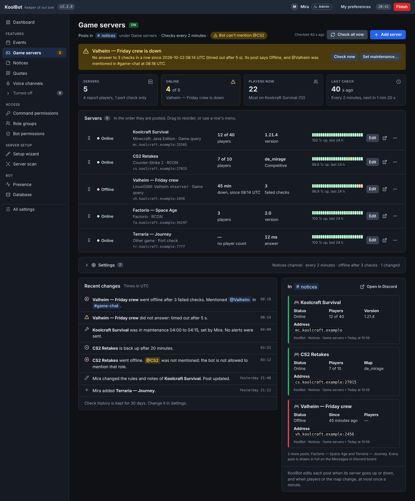
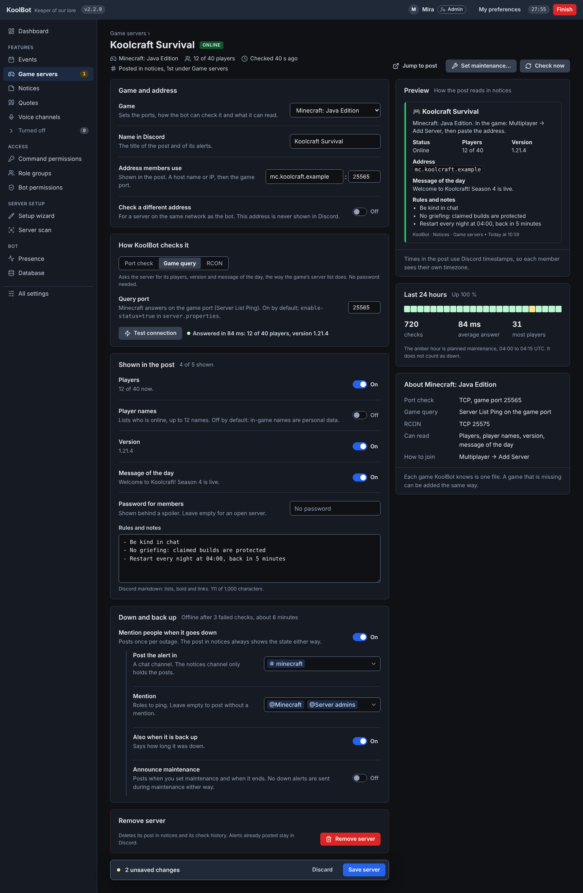
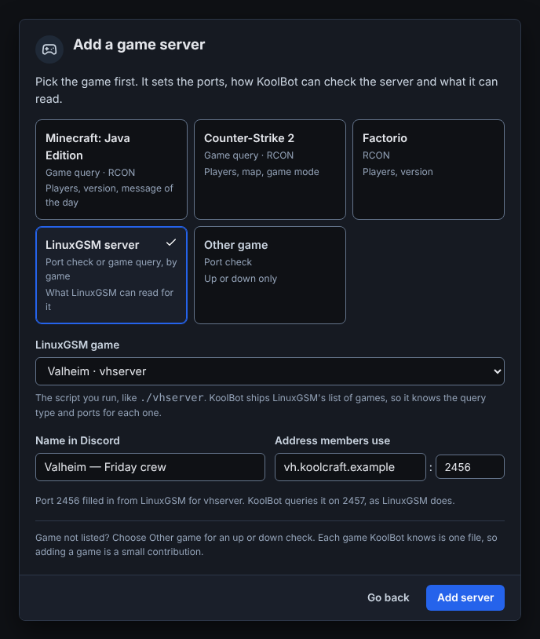

# Pages

The redesigned screens, grouped by the scope that sees them. Each describes what the page shows first and why; the components are in
[components.md](components.md), the patterns in [patterns.md](patterns.md).

## Admin console

### DashboardPage

The Dashboard: state first, then what needs you, and every card links to the page where you act.

1. Four StatTiles: Version, Discord, Database, Permissions.
2. Left column: *Needs you* (problems from Bot permissions and Server scan, each with a button to that page) and *This week in voice* (links to Voice
   analytics).
3. Right column: Features with their on/off status, each linking to its page, and the Server facts.

Read-only: no switches here. Cards are as tall as their content.

**As built (#1322).** Each source is read on its own with a 2.5 s limit (`src/web/dashboard-data.ts`): one that fails or is slow becomes *unavailable*
in its own card and never reads as 0, and the page is the same without it. The Permissions tile counts the problems of the switched-on features, as
the navigation badge does; a check that did not answer says *Not checked*, and while a switched-on feature could not be fully checked the tile says
*Partly checked* rather than that everything is in place. *Needs you* shows at most six rows and then one line that links to Bot permissions. It also
lists the blockers and warnings of the last Server scan, kept for 30 minutes after it finished (`DASHBOARD_SCAN_RETENTION_MS`, #1415) and each
row saying how old the scan is: the Dashboard never starts a scan, so the Server scan page is where one is run. A scan problem is left out only when the
permission check has a row for the same permission or role; one it cannot see (a permission no checked feature uses, the general
roles-above-the-bot warning) stays. *This week in voice* is the last 7 days, shown only while voice tracking is on;
a failed query says it could not be read instead of showing an empty week. *Features* is the sidebar's own list (switched on first, then off, each A
to Z). The right column also holds the *Version* panel with its *Check now* button, the one form on the page, which sets nothing. The alert icons use
the markup from `feature-page.ts` until the shared icon helper (#1369) replaces it.

**As built (#1638).** *Needs you* has one more source: the slash-command check (`CommandManager.checkCommandSync`, read with the same 2.5 s limit). When the
registered commands differ from the ones the switched-on features need, the first row names what to add, remove and update (at most five names, then "and N
more"), says what members see, and links to All settings (`/admin/settings#commands-sync`), where Reload commands is: the Dashboard stays read-only. When the
check could not be made the row says *Not checked* with the reason (`kb-badge--info`, info icon), never "in sync". The row is first so the six-row
cut does not
hide it. All settings shows the same state beside its button as a `kb-status` word (*In sync*, *Out of sync*, *Not checked*) and one sentence.

### EventsPage

The pattern for every feature page (#1301), shown on Events.

1. **Status line** under the title: the On badge and the key values as Mentions and chips. A missing required value, or a missing permission, is a
   warn chip that links to where it is fixed.
2. **The usable part**, with its main actions in the header: *Start now* and *Schedule event*. Then *Live now*, *Upcoming* (no id column, no empty
   columns, Edit and Cancel per row) and *Past events (n)* folded.
3. **Settings (n)**, folded at the bottom. The summary says how many differ from the default. It opens by default when the feature is off or a
   required value is missing, stays open after a save (with the flash), and remembers its state per page.

`renderFeatureSettingsCard()` is shared by 14 pages, so this order lands everywhere at once.

### BotPermissionsPage

Bot permissions (#1306): what to do comes first, then every permission in one matrix.

The intro says Administrator is fine to start with (the Setup wizard asks for it) and that the permissions listed here are the target to narrow the
bot to (#1617).

1. **How to fix**, only when something is missing: a numbered, deduplicated list of steps and *Re-authorise KoolBot*, which opens Discord's bot-invite
   page with every permission the switched-on features need. Whether Discord applies the new bits to the existing role still needs checking; if it
   does not, the steps stay and the button goes.
2. **Permissions**: one row per Discord permission, in Discord's order and words, sorted Missing → Not checked → Has. Status is an icon and a word
   (`kb-perm--missing | --unknown | --has`), and missing rows are tinted `err-bg`. *Where* uses Mentions; *Needed by* lists feature chips. *Role
   position* is a row of its own.
3. **Not needed (n)**, folded: permissions only switched-off features would use, with those features as dashed chips.
4. A *Show all Discord permissions* switch lists every flag, the unused ones marked "Not used by KoolBot".

When nothing is missing, step 1 becomes one green callout: "All permissions your switched-on features need are in place."

### ServerScanPage

Server scan, Overview tab. The read-only inventory of `adopt-view.ts`, reordered so the verdict and what to do next come first.

1. Verdict Callout (ready, or not ready with the blocker count).
2. Tiles: Readiness, Roles, Channels, Other bots; each opens its tab. Permission detail lives on Bot permissions, so the scan links there instead of
   repeating the table.
3. Left: Warnings as IssueRows, Notes folded; Suggestions, each with a button to the page that acts on it.
4. Right: Other bots, one card per bot with a coverage bar and the replacement table folded; Discord native facts.

The full role, channel and bot tables live in their tabs. The *Find channels a bot writes in* switch in the header replaces the `?sample=1` link.

**As built (#1323).** The tabs are `?tab=` links (Overview, Roles, Channels, Other bots, Discord) and the *Find channels a bot writes in* switch is a GET
form, so the page works without JavaScript. The tabs share one scan for a minute, and the header says when Discord was read. Issue rows and callouts carry
their tone icon from `icons.ts`. The Channels tab is the tree described below (#1364).

**As built (#1546).** On the Overview the verdict comes first, then the partial-read callout when there is one, then the tiles. The other tabs keep
the partial-read callout at the top. With the GuildMembers intent off, the Overview says why once, in the folded *Notes*; the *Other bots* panel
carries the bot-list caveat in its footer, and with no bots found the *Other bots* tile says the list may be incomplete.

**As built (#1630).** The switch is named for what it finds, and one line under the title says what it reads, keeps and needs; the 60% rule, the
channel cap and what is kept sit behind an inline *More*. With JavaScript the form submits when the switch changes and *Apply* is hidden; without it,
*Apply* is the same GET. The header says whether this scan used the switch ("with bot message sampling"), and when the sampling stopped early, how
many channels it read and where it stopped. Places that need the sampling (the *Other bots* leftovers, the cleanup page) link to the scan with the
switch on.

### ServerScanChannelsPage

Server scan, Channels tab. The channels as Discord shows them, categories with their channels under them. Each row shows what uses the channel (green
chips), what it looks like it could be (*looks like Quotes* plus *Claim*, which opens Channel claims with the channel filled in), Discord's own flags,
and *Custom permissions* when it is not synced to its category. Filters on top narrow it to what is used, what could be claimed, or what has custom
permissions. A row's overwrites open on demand.

**As built (#1364).** Channels outside a category come first, then each category with its channels under it, text before voice, as Discord lists them.
The filters are `?filter=` links in a `kb-tabs` strip with a count each (`aria-current="true"` marks the filter, `"page"` stays on the section tabs); they
keep `tab` and `sample`, and a filter keeps a category as the heading of any channel that matches. A row's overwrites are an inline `kb-disclosure`
whose summary counts them. *Claim* is a link to `/admin/adopt/claims?channel=&feature=#claim-<id>`, shown only where the claims form offers that
feature for that kind of channel and never on a channel Discord uses (rules, system, public updates). Rows are labelled with `channelMention()` from
`discord-labels.ts`, so each carries its kind icon.

### GameServersPage

Game servers (#1376): one post per game server in Discord that KoolBot keeps up to date, and the alerts that mention a role when a server goes
down. The feature-page pattern, with the down servers first.

1. **Status line** under the title: where the posts go (a Mention), the check interval, and a warn chip for anything that needs fixing, such as
   a role the bot cannot mention. Actions: *Check all now* and *Add server*.
2. A warn Callout per server that is down: since when, what the post and the alert said, with *Check now* and *Set maintenance…*.
3. Tiles: Servers, Online (warn when any is down), Players now, Last check.
4. **Servers**, in the order they are posted: status word and dot, name, game and check method, the address in mono, two facts (players, then
   map or version), an UptimeStrip and *Edit*, *Jump to post* and a row menu. Rows drag to reorder; the menu has *Move up* / *Move down*.
   Saving a new order re-posts those posts in Discord (`discord.md`, *Posts that track live state*), and the page says so before it saves.
5. *Settings (n)*, folded, with the summary line.
6. *Recent changes* (state changes, alerts sent or not, maintenance, edits; times in UTC) beside *In #notices*, the posts as DiscordEmbed sketches.

### GameServerEditPage

One server, in two columns. The form on the left, saved with one SaveBar:

- **Game and address**: the game, the name in Discord, the address and port members use; *Check a different address* nested under its switch.
- **How KoolBot checks it**: a SegmentedControl of the methods the game supports (*Port check*, *Game query*, *RCON*), one line on what each
  does, its ports and setup hint, and *Test connection* with its result as a status word. The RCON password is write-only: *Change*, never shown.
- **Shown in the post**: one SettingRow per field the game reads, each showing its current value (*12 of 40 now*); player names off by default;
  the member password; *Rules and notes*.
- **Down and back up**: the alert channel and roles (Pickers), the back-up post and *Announce maintenance*, nested under *Mention people when it
  goes down*.
- **Remove server** last, in a danger panel, behind a Dialog.

On the right: the post as it will read (DiscordEmbed), the last 24 hours (UptimeStrip and numbers) and *About <game>*, read from the game's file.

### AddGameServerDialog

Adding a server starts with the game, because the game sets the ports, the check methods and what can be read. PresetCards of the games KoolBot
knows, *Other game* last; *LinuxGSM server* adds a searchable *LinuxGSM game* picker. Then the name and the address, with the port filled in
from the game. The footer line says how a missing game gets added: each game is one file.

### WizardAccessPage

The Setup wizard's Access step: who can do what, before any channel is set up.

- Steps: Choose features → **Access** → Features → Review.
- One AccessCard per scope that maps roles: Admins (`/config`), Moderators and Event hosts (both `/me`). Each maps Discord roles through a Picker and
  writes a role group with the matching capability. There is no Members card: members have no role mapping, and everyone on the server may use `/me`
  (narrowing it is on Command permissions).
- **Creating a role.** Each Picker also offers *Create new role: 'typed text'* as its last row (the Picker's create row, see [components.md](components.md#picker)).
  There are no fixed names: the admin types the name. A text that matches an existing role, in any case, selects that role instead. Choosing the row only
  marks the name ("Quartermaster (will be created)"); the step saves it beside the picks and nothing is created on the step. A name typed under
  several cards makes one role, whatever the case. Admins imply the other scopes, so a name typed under Admins is mapped to Admins only; a name typed under
  Moderators and Event hosts (without Admins) keeps both, which are independent. A refused save saves nothing and draws the picks and the typed names once more.
  - The help line under each Picker reads "Leave it empty for none." and, when the bot can create roles, "To create a role, type its name and choose Create
    new role. It is created with no Discord permissions and nobody is added to it; Review lists it first." Without *Manage Roles* there is no row and the
    line gives the reason instead; when that cannot be read there is neither row nor reason, and a role already chosen stays drawn as pending.
  - **Review** shows the Role access panel, then the Panel *Roles to create*: one row per role, "Create the role @Name (no Discord permissions, nobody
    added)", with "Mapped to Moderators." under it, and the footer "Nothing is created until you apply. If applying fails, KoolBot removes what it
    created and puts the role groups back; anything it keeps because something now points at it, or could not remove, is named." An error Callout *The
    roles can't be created* (the reason, then "Nothing is changed until this is fixed. Go back to Access and change it, or fix it in Discord and open Review
    again.") disables Apply. The role group that maps the new role shows in the Role access table.
  - **A typed name that is an existing role** creates nothing. Review opens with a Callout, *A name you typed is an existing role*: "@Name is an existing role,
    3 members hold it now. It will be mapped to Admins; no role is created." (or "its members could not be counted") and "Everyone who already holds an
    existing role gets what its scope allows. Go back to Access if you meant a new role." It is a warning when a scope is Admins or Moderators and a plain
    Callout when it is Event hosts only. The refusals that apply to a picked role (a managed role, one above the bot, *@everyone*, one a feature hands out)
    apply to it too.
  - **Apply** creates the roles first, then writes the role groups, then the channels and settings. If something after the roles fails, KoolBot puts the role
    groups back and removes the roles it created, as far as it can: a role something now points at is kept and named, and a role it could not remove or
    check is named as possibly still there, so the flash can report roles left behind. If the role groups changed while it was creating ("The role groups
    changed since you opened Review"), Apply writes no role groups and the created roles go through the same cleanup; a role a group now points at is kept.
  - This replaces the *Create @Event host* switch (#1365): all three cards behave the same.
- A callout warns when a switched-on feature has nobody to run it ("Events is on and nobody can host yet"); a role chosen to be created counts as someone.
- Components: Picker (create row and help line), AccessCard, Panel, List, Callout `--err`, Mention. No new component.

### WizardAdministratorCheck and WizardDonePage (#1617)

The Setup wizard makes sure the bot has Administrator, then helps narrow it. Both parts are drafted from existing components; the wording is a
proposal until the owner settles it.

- The first page and **Review** open with a Callout: `--ok` "The bot has Administrator"; `--warn` "The bot does not have Administrator" with what may
  fail, how to grant it (invite link, or the bot's role in Discord) and a neutral small *Check again*; plain "Administrator could not be checked" with
  *Check again*, claiming neither way. A missing Administrator never blocks Apply.
- **Review** adds a Switch row, *Continue without Administrator*, posted with the Apply form. Apply is not disabled for it; the server stops with a message
  back on Review until the switch is on.
- The wizard ends on `/admin/wizard/done`, not a fifth step in the Steps bar: *Narrow the bot's permissions*, optional, read-only. A Panel of the
  permissions the switched-on features need with chips for the features, a Panel *Used, but not checked here* (the permissions KoolBot uses that
  Bot permissions does not check, never called unneeded), a folded *Not needed* list of what only switched-off features use, a Panel of four numbered
  steps to swap
  Administrator in Discord, and one primary button, *Open Bot permissions*, next to *Skip for now*.

### WizardFeatureStep and Review, creating channels and categories

The Setup wizard has no step of its own for channels. Each Features page (one per chosen feature) is drawn from the same controls as All settings, and a
setting that points at a channel or a category offers the Picker's create row where the schema flags it: ten post-channel settings and the three category
settings. The post channels are *Announcement channel* (the weekly recap), *Quote channel*, *Birthday announcement channel*, *Welcome channel*, *Rules
channel*, *Event announcement channel*, *LFG channel*, *Reaction-role message channel*, *Notices channel* and *Role-change announcements channel*. The
categories are *Managed category* (the managed voice category), *Event channel category* and *Ticket channel category*. *Celebrations channel* is flagged
but is not on a wizard page, so only All settings offers it there. Voice settings and log channels never offer the row.

- Choosing the row only marks the name on the page ("Quote Wall (will be created)") and the step saves it with the other answers. Nothing is created on
  the step. Opening the step again draws the pending name again; choosing a real channel, the empty row or switching the feature off drops it. A text
  channel setting whose permission could not be read shows the stored value on a later visit; a category stays drawn as pending.
- With *Manage Channels* missing there is no row and the Picker's status line gives the reason while a name is typed; with the permission unreadable there is
  neither. *Review* checks the permission too, so Apply is blocked with the reason instead of failing there.
- **Review** lists each channel and category in the Panel *Channels and categories to create*, after Role access: "Create the text channel *quote-wall* for
  Quote channel" with "Not in a category. Visible to everyone who can see the server." under it, or "Create the category *Support* for Ticket channel
  category" with "Visible to everyone who can see the server." Names are Mentions: a channel with its icon, a category in capitals and never with a `#`.
  For the managed voice category the line adds "The lobby is created in it by the voice feature, not by this step." The footer reads "Nothing is created
  until you apply. If applying fails, KoolBot removes what it created; anything it keeps because something now points at it, or could not remove, is
  named." The table *Settings to apply* shows the setting as "# quote-wall (will be created)", "# quote-wall (existing channel)" or, for a category, its
  folder glyph and "(existing category)". A hidden `channelPlanId` carries the plan Apply must reproduce.
- When creating cannot work (the bot cannot create or cannot be checked, a name matches two channels, the server cannot be read) an error Callout, *The
  channels can't be created*, names why, "Nothing is changed until this is fixed. Go back to the step that plans the channel, or fix it in Discord and
  open Review again.", and Apply is disabled with "Apply is blocked until the problems above are fixed." under it.
- Two settings that type the same new name (any case) share one channel, and the Review row names both settings. A text channel and a category with the
  same name are two. A name that matches one existing text channel anywhere on the server selects it with its own parent.
- **Apply** creates the roles, then the channels and categories in one go, then writes the settings with their ids. A success reads "Wizard applied 4
  settings and 1 role group change and created 1 role and 1 channel and 1 category." What a failure says depends on where it failed:
  - A refusal before anything was created starts "Nothing was applied."
  - A create that fails (a role, or a channel or category) starts "The settings were not applied." and then the cause. What the same call had created is
    removed again; one that could not be removed or checked is named ("May still exist (not removed or checked): …. Check them in Discord before applying
    again.").
  - A failure after the creation, when the settings are written, starts "Wizard apply failed: …". When every written setting was rolled back it ends "no
    changes were applied. You can retry." When a rollback failed it names the settings that are saved and in effect ("Could not roll back …, these settings
    are saved"), and when the reload failed it says to run `/config reload`. When a created channel or role is still there it says "The settings were not
    saved." instead of "No changes were applied". A failure that throws starts "The settings could not be applied."
  - After such a failure, each created channel is decided on its own from a fresh read of the stored settings: one a saved setting points at is kept and
    named ("Kept, because a saved setting points at it: …"), the rest are removed ("The channels or categories created for this apply were removed again."),
    and one that could not be removed or checked is named as above. So a failed Apply can leave channels, roles or settings in place; the flash names
    them.
- Components: Picker (create row), Panel, List, Callout `--err`, Mention. No new component.

### Settings pages and forms, creating on save

The Picker's create row on All settings, on the Settings card of the feature pages, and on the Announcements and Polls forms. It offers the same three
things as above, except roles: the settings and the forms offer text channels and the three categories only. There is no Review step, so the plan and the
create happen in the save.

- **All settings and the feature pages.** The page asks the permission once and offers the row on every flagged setting. Saving a section reads the typed
  names first and creates them only when nothing else in the section was refused. One apply creates all of them: if the creation fails, what that save
  created is removed again, nothing is stored, and the flash reads "No changes saved — N invalid values in <section>: <key> (<reason>), …", with the reason under
  every setting that asked. If the creation succeeds, the settings are then written one by one, and the save can be partial: a setting whose write fails is
  reported ("Saved 2/3 in <section>. Failed: <key> (<reason>)."), the others stay saved, and the created channels stay, named in the flash. A section with a
  channel and a category (Events) checks the permission for each kind.
- **A repeated name.** Two settings that type the same new category share one category. Two settings that type the same new text channel name are refused
  ("appears more than once"); the wizard, in contrast, makes one channel for both.
- **Announcements and Polls.** The *Channel* field of the create and one-off announcement forms and the poll schedule forms (create and edit) takes the
  same row. The form is checked first; the channel is created only after every other field passed, so an invalid form creates nothing. A failed create refuses
  the form with the reason under *Channel* and the typed name kept, and nothing is stored. If the channel was created and the form's own save then fails, the
  flash ("Failed to create announcement: …") still names the channel, and it stays. The *Role to ping* field of the poll forms offers no row.
- **What the flash says.** The sentence names what was created and what was selected, with the channel as the pages write it (`# name`) and a category with
  its folder: "Saved 1 setting in quotes. Created # quote-wall for Quote channel.", "Used the existing # quote-wall for Quote channel.", "Created category
  📁 Community for Managed category and Ticket channel category." On the forms it follows the form's own sentence: "Created announcement 4. Created # news for
  Channel." Where a later write fails after the creation, the flash still names the channel it created, and the channel stays.
- **Limits.** When the permission is unreadable, a typed text channel name that a Settings page draws again would show as unavailable; a category and the
  forms keep it as "(will be created)". Without JavaScript there is no row.
- Components: Picker (create row), Callout, the page's existing flash. No new component.

## Event host

### HostEventsPage

*Your events*: the home of the Event host scope, for people who host but are not admins or moderators.

- Header: why they can host, under the title ("You can host because you are in @Event hosts"), *Start now* and *New event*.
- *Live now* (or one line saying how Start now works), *Upcoming* with Edit and Cancel, *Past events* folded.
- Only events the person created; server-wide event settings stay with admins.

**As built (#1319).** `/me/events` (`me-events-page.ts`, `routes/me-events.ts`). The scope line is the shell's own (`renderScopeWhy`), so the page header
carries only the title and one sentence about *Start now* and *New event*. *Start now* is a link to the New event form with *Now* preselected
(`?when=now`), not a one-click action: a title is still needed. Both buttons are left out while Events is off, and a callout says so. *Live now* has
one line saying how Start now works when empty; a live row links to its host panel and has no Cancel (a running event is ended from its panel).
Running is `isEventRunning`: active and the start has arrived, so an event whose channel was prepared early stays in *Upcoming*.
*Upcoming* rows have Edit and a confirmed Cancel (`POST /me/events/:id/host/cancel`, this occurrence only); the empty state links to *New event*.
*Past events* is a folded `kb-disclosure` with a count. The list is filtered on the session's server and user, an admin session included, and
leaves adopted events out as the overview card does. A failed read says so instead of showing an empty list.

### NewEventPage

Creating an event, here as an event host. Admins get the same form on a page of their own, `/admin/events/new`, which the Events page opens, with
*Repeat* added.

1. **When** first: *Now*, *In 15 min*, *In 30 min*, *In 1 hour*, *Pick date & time*. *Now* creates the channels at once and announces the event as
   happening now. Native date and time inputs; the timezone select puts the server's zone first.
2. **Details**: title, where to announce (Picker), duration (preset minutes).
3. **Groups**: one switch. When on, PresetCards first and a one-line summary; *Customise* holds the compact rows (marker, name, size, tag), *Generate*
   and *Add a group*. Group leaders and clan tags follow, with their options nested under them. Lead time sits in *Advanced*.
4. *Save setup as a preset* and *Create event*.

The groups block is one component, shared with the host panel and the preset editor (#1299).

### HostPanelPage

The host panel for a live event, as an event host who is neither admin nor moderator sees it (the Hosting section in the sidebar).

- Toolbar: Unlocked/Locked, then *Randomise…* and *Move people…* (each opens a Dialog with its options), then *Send to teams*.
- Board: a column per team plus *Not in a team*. People are dragged between columns, with a team menu per person as the no-JavaScript fallback; each
  shows where they are connected now.
- At the bottom, folded: *Event settings* (Group leaders and Clan tags, children nested) and *Change the groups* (add, remove, preset, switch off).
  Each summary states the current values.

**As built (#1319, #1424, #1518).** The panel is in the Hosting section (`active` is `/me/events`, breadcrumb *Your events*). The body is the header,
the problems, the board (`src/web/host-board-view.ts`), the folded *Group details*, *End the event*, then the two folds.

- *Header*: the `h1` is *Host panel* with the state as a `kb-badge` after it (*Live*, *Planned*, *Ended*, *Cancelled*: `eventStateWord`, shared with
  *Your events*); `kb-pagehead__sub` is the event's title, a second one carries the description; `kb-pagehead__meta` has one icon span each for the
  start, duration, repeat, main channel and an adopted event's note.
- *Problems*: the permission notice, the group-channel warnings and the clan tag warnings are warn Callouts directly under the header, before the board.
- *Group details*: a closed `kb-disclosure` under the board with who may join each group, whether its channel exists, when channels are made, the
  Captains lobby line and the clan tags status. It keeps the table's every column. An ended or cancelled event has no board, so it shows this fold
  under its read-only Callout.
- *End the event*: a `kb-panel--danger` with one line and a `kb-btn--danger` *End event now* that opens the Dialog (`data-confirm="End this event
  now?"`, the list is `endEventItems`). Without script a `noscript` block shows the same list and a required tick box; the server's `confirm=1`
  check stays. An event that has not started gets a plain panel with one sentence.

- *Toolbar* (`kb-toolbar`, `role=group` with a label): the lock state as a `kb-badge` with *Lock groups* / *Unlock groups*, a separator, *Randomise…* and
  *Move people…*, then *Send to teams* at the end. *Randomise…* and *Move people…* are `details.kb-toolbar__action` (a disclosure, so they work
  without script); the page script moves the panel into a `dialog.kb-dialog` with *Go back*, and puts it back on close. A control that cannot work
  is disabled and `aria-describedby` points at the line under the toolbar that says why. *Send to teams* is a plain form, with no confirm dialog.
- *Board* (`kb-board`): a `kb-board__col` per team, then `kb-board__col--loose` *Not in a team*. A column head is the tag (`kb-team__tag`), the name
  (`h3`) and the count; a sized team has a `kb-meter` with an `aria-label`. A person is `li.kb-board__person`: avatar initial, name, a leader badge
  with the crown and the label, *where* (*In Main channel*, *In Reds* or *Not connected*), and a *Move* menu (`kb-disclosure--inline`) with a
  labelled select and the *Add to / Move to team* and *Not in a team* buttons. The menu is the baseline for keyboard and no-JavaScript use.
- *Drag* is progressive enhancement: the script sets `draggable` on each person, highlights the column under the pointer (`.is-over`), and on a drop
  fills in and submits that person's own menu form, so there is no separate route. A refused drop (a full team) is read out through a polite live
  region. Touch has no drag; the menu is the way.
- *Folds* at the bottom, as `kb-disclosure`: *Event settings* (lead time, *Group leaders* and *Clan tags* with their children, the leader label and what
  leaders changed) and *Change the groups* (names and sizes, preset, add, remove, switch off). Their summaries state the current values (for example
  *Channels 20 min before the start · Captains on · Clan tags on* and *2 groups: Reds, Blues*). They open only after a settings save.

## Moderator

### ModerationPage

*Mod log*: the home of the Moderator scope, for people who moderate but are not admins.

- Header: why they see it, once, under the title ("You can moderate because you are in @Moderator"). The sidebar is the navigation: no Mod log /
Command audit tabs.
- Tiles: open cases (warn when any), actions in the last 7 days, timeouts running now.
- *Open cases* with *Review*, then *Actions* (filter by kind) with mentions for channels and a link to each case.
- Moderators read the log and review cases; moderation settings stay with admins. Tickets joins this section once the server switches it on.

## Member

### MemberOverviewPage

My preferences, Overview tab, for a member who also hosts (so the sidebar shows You and Hosting). Only what the server has switched on: a live event
the person hosts comes first, then one FeatureCard per preference with its current value, and the account ids as one line of fine print. A member with
no other scope sees the same page without a sidebar.
