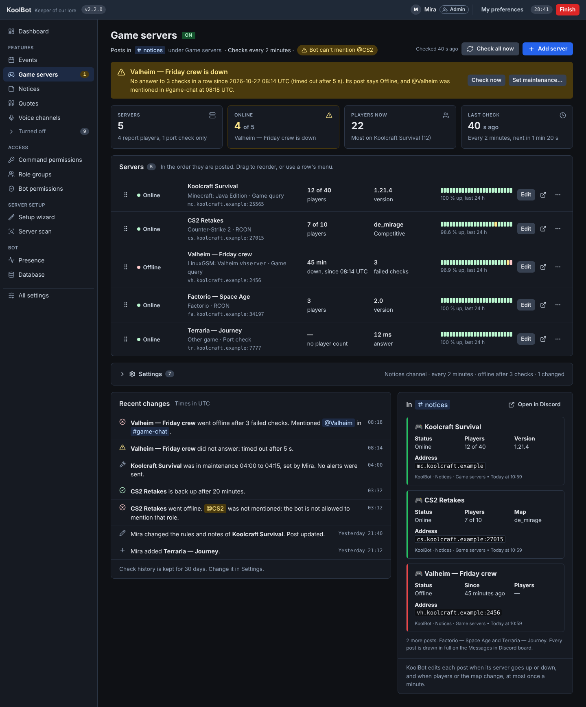
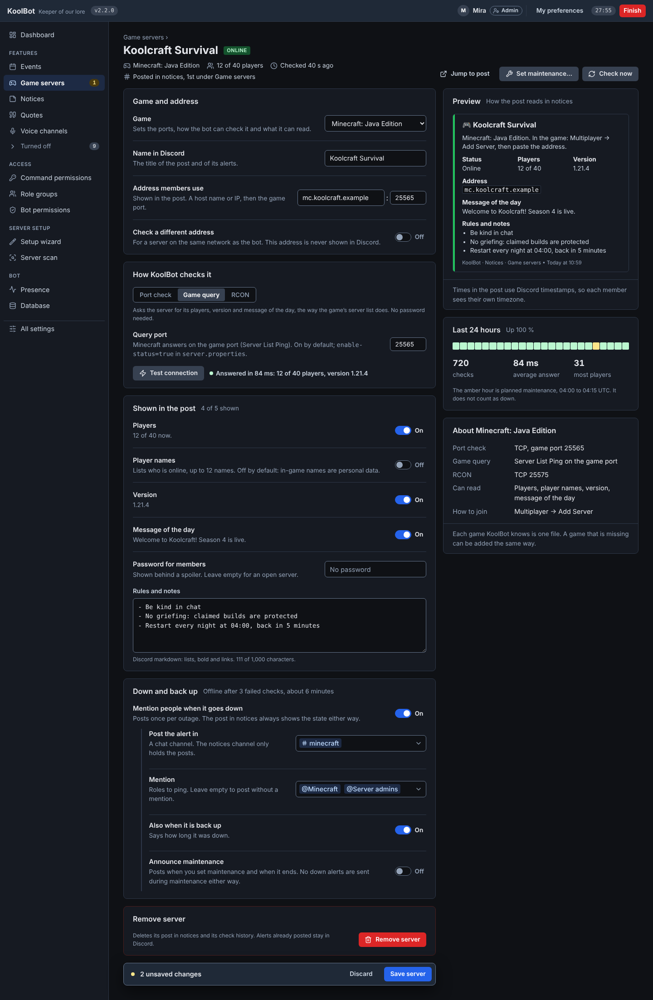
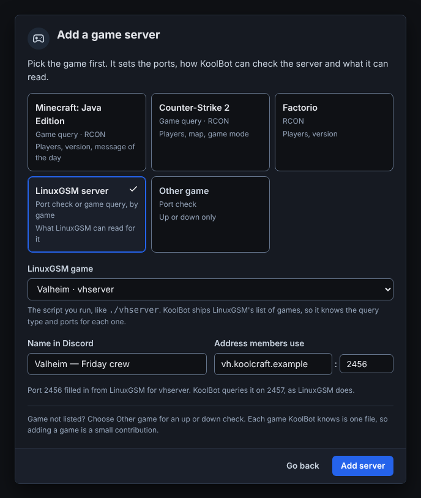

# Pages

The redesigned screens, grouped by the scope that sees them. Each describes what the page shows first and why; the components are in
[components.md](components.md), the patterns in [patterns.md](patterns.md).

## Admin console

### DashboardPage

The Dashboard: state first, then what needs you, and every card links to the page where you act.

1. Four StatTiles: Version, Discord, Database, Permissions.
2. Left column: *Needs you* (problems from Bot permissions and Server scan, each with a button to that page) and *This week in voice* (links to Voice
   analytics).
3. Right column: Features with their on/off status, each linking to its page, and the Server facts.

Read-only: no switches here. Cards are as tall as their content.

**As built (#1322).** Each source is read on its own with a 2.5 s limit (`src/web/dashboard-data.ts`): one that fails or is slow becomes
*unavailable* in its own card and never reads as 0, and the page is the same without it. The Permissions tile counts the problems of the
switched-on features, as the navigation badge does; a check that did not answer says *Not checked*. *Needs you* shows at most six rows and
then one line that links to Bot permissions. It also lists the blockers and warnings of a Server scan, but only one that finished in the last
minute: the Dashboard never starts a scan, so the Server scan page is where one is run. A scan problem that is a missing permission or role
position is left out, because the permission check already has a row for it. *This week in voice* is the last 7 days, shown only while voice
tracking is on. *Features* is the sidebar's own list (switched on first, then off, each A to Z). The right column also holds the *Version*
panel with its *Check now* button, the one form on the page, which sets nothing. The alert icons use the markup from `feature-page.ts` until the
shared icon helper (#1369) replaces it.

### EventsPage

The pattern for every feature page (#1301), shown on Events.

1. **Status line** under the title: the On badge and the key values as Mentions and chips. A missing required value, or a missing permission, is a
   warn chip that links to where it is fixed.
2. **The usable part**, with its main actions in the header: *Start now* and *Schedule event*. Then *Live now*, *Upcoming* (no id column, no empty
   columns, Edit and Cancel per row) and *Past events (n)* folded.
3. **Settings (n)**, folded at the bottom. The summary says how many differ from the default. It opens by default when the feature is off or a
   required value is missing, stays open after a save (with the flash), and remembers its state per page.

`renderFeatureSettingsCard()` is shared by 14 pages, so this order lands everywhere at once.

### BotPermissionsPage

Bot permissions (#1306): what to do comes first, then every permission in one matrix.

1. **How to fix**, only when something is missing: a numbered, deduplicated list of steps and *Re-authorise KoolBot*, which opens Discord's bot-invite
   page with every permission the switched-on features need. Whether Discord applies the new bits to the existing role still needs checking; if it
   does not, the steps stay and the button goes.
2. **Permissions**: one row per Discord permission, in Discord's order and words, sorted Missing → Not checked → Has. Status is an icon and a word
   (`kb-perm--missing | --unknown | --has`), and missing rows are tinted `err-bg`. *Where* uses Mentions; *Needed by* lists feature chips. *Role
   position* is a row of its own.
3. **Not needed (n)**, folded: permissions only switched-off features would use, with those features as dashed chips.
4. A *Show all Discord permissions* switch lists every flag, the unused ones marked "Not used by KoolBot".

When nothing is missing, step 1 becomes one green callout: "All permissions your switched-on features need are in place."

### ServerScanPage

Server scan, Overview tab. The read-only inventory of `adopt-view.ts`, reordered so the verdict and what to do next come first.

1. Verdict Callout (ready, or not ready with the blocker count).
2. Tiles: Readiness, Roles, Channels, Other bots; each opens its tab. Permission detail lives on Bot permissions, so the scan links there instead of
   repeating the table.
3. Left: Warnings as IssueRows, Notes folded; Suggestions, each with a button to the page that acts on it.
4. Right: Other bots, one card per bot with a coverage bar and the replacement table folded; Discord native facts.

The full role, channel and bot tables live in their tabs. The ownership-hints switch in the header replaces the `?sample=1` link.

**As built (#1323).** The tabs are `?tab=` links (Overview, Roles, Channels, Other bots, Discord) and the ownership-hints switch is a GET form, so
the page works without JavaScript. The tabs share one scan for a minute, and the header says when Discord was read. Issue rows and callouts carry
no icon yet: the shared icon helper in `app-shell.ts` has none of the alert icons. The Channels tab is still a flat table; the tree, filters and
*Claim* are tracked in #1364.

### ServerScanChannelsPage

Server scan, Channels tab. The channels as Discord shows them, categories with their channels under them. Each row shows what uses the channel (green
chips), what it looks like it could be (*looks like Quotes* plus *Claim*, which opens Channel claims with the channel filled in), Discord's own flags,
and *Custom permissions* when it is not synced to its category. Filters on top narrow it to what is used, what could be claimed, or what has custom
permissions. A row's overwrites open on demand.

### GameServersPage

Game servers (#1376): one post per game server in Discord that KoolBot keeps up to date, and the alerts that mention a role when a server goes
down. The feature-page pattern, with the down servers first.

1. **Status line** under the title: where the posts go (a Mention), the check interval, and a warn chip for anything that needs fixing, such as
   a role the bot cannot mention. Actions: *Check all now* and *Add server*.
2. A warn Callout per server that is down: since when, what the post and the alert said, with *Check now* and *Set maintenance…*.
3. Tiles: Servers, Online (warn when any is down), Players now, Last check.
4. **Servers**, in the order they are posted: status word and dot, name, game and check method, the address in mono, two facts (players, then
   map or version), an UptimeStrip and *Edit*, *Jump to post* and a row menu. Rows drag to reorder; the menu has *Move up* / *Move down*.
   Saving a new order re-posts those posts in Discord (`discord.md`, *Posts that track live state*), and the page says so before it saves.
5. *Settings (n)*, folded, with the summary line.
6. *Recent changes* (state changes, alerts sent or not, maintenance, edits; times in UTC) beside *In #notices*, the posts as DiscordEmbed sketches.

### GameServerEditPage

One server, in two columns. The form on the left, saved with one SaveBar:

- **Game and address**: the game, the name in Discord, the address and port members use; *Check a different address* nested under its switch.
- **How KoolBot checks it**: a SegmentedControl of the methods the game supports (*Port check*, *Game query*, *RCON*), one line on what each
  does, its ports and setup hint, and *Test connection* with its result as a status word. The RCON password is write-only: *Change*, never shown.
- **Shown in the post**: one SettingRow per field the game reads, each showing its current value (*12 of 40 now*); player names off by default;
  the member password; *Rules and notes*.
- **Down and back up**: the alert channel and roles (Pickers), the back-up post and *Announce maintenance*, nested under *Mention people when it
  goes down*.
- **Remove server** last, in a danger panel, behind a Dialog.

On the right: the post as it will read (DiscordEmbed), the last 24 hours (UptimeStrip and numbers) and *About <game>*, read from the game's file.

### AddGameServerDialog

Adding a server starts with the game, because the game sets the ports, the check methods and what can be read. PresetCards of the games KoolBot
knows, *Other game* last; *LinuxGSM server* adds a searchable *LinuxGSM game* picker. Then the name and the address, with the port filled in
from the game. The footer line says how a missing game gets added: each game is one file.

### WizardAccessPage

The Setup wizard's Access step: who can do what, before any channel is set up.

- Steps: Features → **Access** → Channels → Review.
- One AccessCard per scope: Admins (`/config`), Moderators, Event hosts and Members (all `/me`). Each maps Discord roles through a Picker, or offers
  to create the role (*Create @Event host*), and writes a role group with the matching capability.
- A callout warns when a switched-on feature has nobody to run it ("Events is on and nobody can host yet").

## Event host

### HostEventsPage

*Your events*: the home of the Event host scope, for people who host but are not admins or moderators.

- Header: why they can host ("You can host because you are in @Event hosts"), *Start now* and *New event*.
- *Live now* (or one line saying how Start now works), *Upcoming* with Edit and Cancel, *Past events* folded.
- Only events the person created; server-wide event settings stay with admins.

### NewEventPage

Creating an event, here as an event host. Admins get the same form from the Events page.

1. **When** first: *Now*, *In 15 min*, *In 30 min*, *In 1 hour*, *Pick date & time*. *Now* creates the channels at once and announces the event as
   happening now. Native date and time inputs; the timezone select puts the server's zone first.
2. **Details**: title, where to announce (Picker), duration (preset minutes).
3. **Groups**: one switch. When on, PresetCards first and a one-line summary; *Customise* holds the compact rows (marker, name, size, tag), *Generate*
   and *Add a group*. Group leaders and clan tags follow, with their options nested under them. Lead time sits in *Advanced*.
4. *Save setup as a preset* and *Create event*.

The groups block is one component, shared with the host panel and the preset editor (#1299).

### HostPanelPage

The host panel for a live event, as an event host who is neither admin nor moderator sees it (the Hosting section in the sidebar).

- Toolbar: Unlocked/Locked, then *Randomise…* and *Move people…* (each opens a Dialog with its options), then *Send to teams*.
- Board: a column per team plus *Not in a team*. People are dragged between columns, with a team menu per person as the no-JavaScript fallback; each
  shows where they are connected now.
- At the bottom, folded: *Event settings* (Group leaders and Clan tags, children nested) and *Change the groups* (add, remove, preset, switch off).
  Each summary states the current values.

## Moderator

### ModerationPage

*Mod log*: the home of the Moderator scope, for people who moderate but are not admins.

- Header: why they see it ("You see it because you are in @Moderator").
- Tiles: open cases (warn when any), actions in the last 7 days, timeouts running now.
- *Open cases* with *Review*, then *Actions* (filter by kind) with mentions for channels and a link to each case.
- Moderators read the log and review cases; moderation settings stay with admins. Tickets joins this section once the server switches it on.

## Member

### MemberOverviewPage

My preferences, Overview tab, for a member who also hosts (so the sidebar shows You and Hosting). Only what the server has switched on: a live event
the person hosts comes first, then one FeatureCard per preference with its current value, and the account ids as one line of fine print. A member with
no other scope sees the same page without a sidebar.
